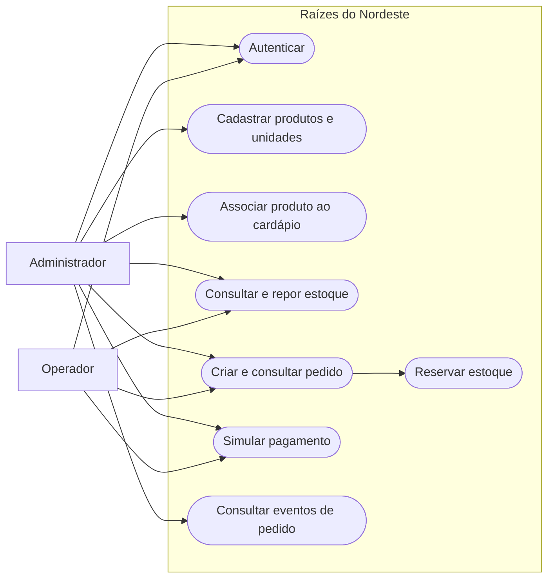
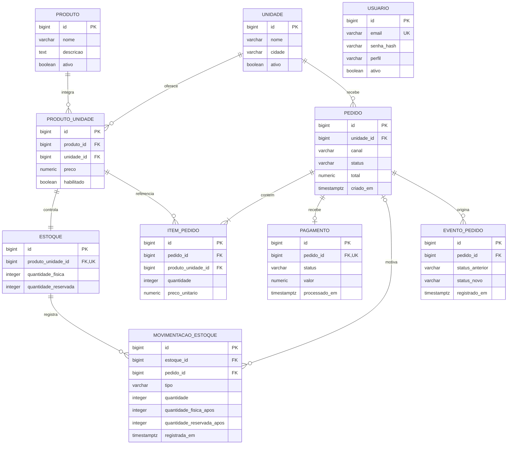
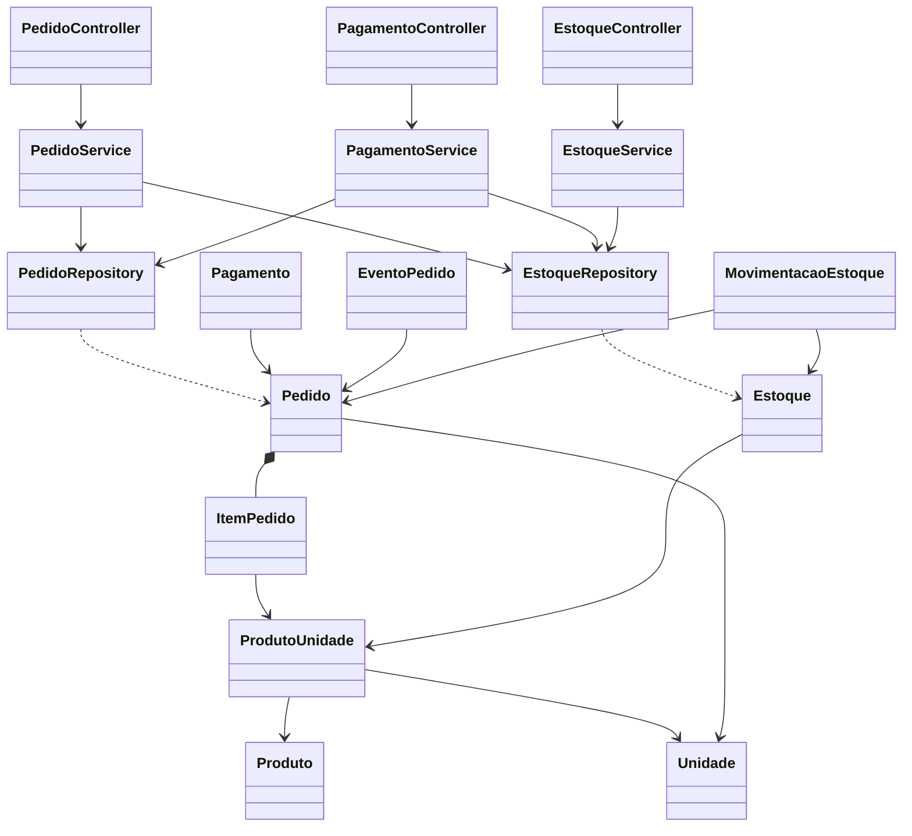

# Especificação da API Raízes do Nordeste

## Escopo e requisitos

O MVP atende equipes da rede de restaurantes que registram pedidos recebidos por aplicativo, totem, balcão, retirada ou web. `ADMIN` configura o catálogo e consulta a auditoria de pedidos. `OPERADOR` consulta o catálogo, repõe estoque e processa pedidos. Os canais identificam a origem da venda. Os dois perfis representam a equipe da rede.

| ID | Requisito funcional | Critério de aceitação |
| --- | --- | --- |
| RF01 | Cadastrar produtos e filiais | O administrador cadastra os registros e consulta seus identificadores. |
| RF02 | Configurar cardápio por filial | Um produto tem um vínculo único com cada filial, com preço, disponibilidade e estoque próprios. |
| RF03 | Consultar e repor estoque | A API expõe os saldos físico, reservado e disponível. A reposição registra uma movimentação. |
| RF04 | Criar e consultar pedidos | A criação exige itens de uma única filial, seleciona o preço vigente e reserva quantidades. |
| RF05 | Simular pagamento | A aprovação baixa o saldo físico e a reserva. A recusa libera a reserva. Um segundo resultado retorna `409`. |
| RF06 | Autenticar e autorizar | O login emite um JWT. Uma credencial inválida retorna `401` e um perfil insuficiente recebe `403`. |
| RF07 | Registrar auditoria | As mudanças de estado do pedido e de estoque produzem registros com data e hora. A consulta de eventos do pedido é administrativa. |

| ID | Requisito não funcional | Critério de aceitação |
| --- | --- | --- |
| RNF01 | Integridade transacional | Duas tentativas simultâneas para a última unidade resultam em um pedido aceito e um `409`. Uma falha anula a transação inteira. |
| RNF02 | Segurança | Senhas armazenadas com BCrypt, JWT assinado com expiração e restrição de rotas por perfil. HTTPS é requisito de implantação. |
| RNF03 | Evolução do banco | Flyway versiona as alterações. O Hibernate valida o schema na inicialização. |
| RNF04 | Contrato HTTP | OpenAPI e coleção de testes descrevem as rotas. Erros esperados seguem `application/problem+json`. |
| RNF05 | Privacidade | Cada dado pessoal tem finalidade explícita, acesso restrito e prazo de retenção definido pelo responsável. |
| RNF06 | Valores monetários | A API usa `BigDecimal` e o banco usa `NUMERIC` com duas casas decimais. O pedido guarda o preço unitário vigente no momento da criação. |

## Casos de uso

## Modelo de dados

## Diagrama de classes

Na criação do pedido, o serviço bloqueia os registros de estoque em ordem crescente de `produtoUnidadeId` antes de verificar e reservar o saldo. O pagamento bloqueia primeiro a linha de pedido para serializar tentativas concorrentes e adota a mesma ordem para o estoque. A transação engloba os saldos, o resultado, a movimentação e os eventos correspondentes. As restrições SQL preservam a integridade mesmo quando o dado é escrito fora da interface HTTP.

## LGPD e governança

| Informação | Finalidade | Uso e retenção propostos |
| --- | --- | --- |
| E-mail profissional e perfil | Autenticar a equipe e limitar ações | Acesso restrito à gestão de contas. Desativar após o fim do vínculo e avaliar a eliminação conforme a finalidade e as obrigações aplicáveis. |
| Hash BCrypt | Verificar a senha no login | Acesso restrito à aplicação. Eliminar com a conta quando a retenção cessar. |
| Identificador e validade do JWT | Autorizar a sessão da equipe | Token temporário enviado no cabeçalho. Evitar registrá-lo em logs. |
| Pedido, pagamento simulado e auditoria | Operar a rede e apurar alterações | O MVP registra canal, valores, estados e horários. A política de retenção depende da finalidade operacional e de eventual obrigação legal aplicável. |

O MVP utiliza contas da equipe e o pedido dispensa nome, CPF, telefone e dados de cartão do cliente. A organização deve documentar a base legal aplicável, os responsáveis, a política de retenção, as medidas de segurança e o atendimento aos titulares antes de um uso real. Em ações facultativas de marketing, a proposta usa consentimento específico, registro de finalidade e versão do aviso e revogação acessível. A exclusão ou anonimização deve considerar as hipóteses legais de conservação. Referência oficial. [Lei nº 13.709/2018, arts. 6º a 9º, 15 a 18 e 46](https://planalto.gov.br/ccivil_03/_ato2015-2018/2018/lei/l13709compilado.htm)

## Proposta para fidelidade e promoções

**Fidelidade.** Criar uma conta opcional ligada a um identificador de cliente e um extrato de pontos com créditos, débitos e expirações. Creditar apenas pedidos pagos, com chave única por pedido e programa. Definir saldo a partir de lançamentos auditáveis, publicar validade e registrar estornos. Separar a adesão ao programa das preferências de comunicação comercial.

**Promoções.** Parametrizar período, filiais, canais, condições de elegibilidade, limite de uso e regras de cumulatividade. Exibir o desconto antes da confirmação e registrar o ajuste por item ou pedido. Reservar o uso de cupons com limite concorrente e preservar o preço bruto e líquido do momento da compra. Incluir cenários para expiração, limite concorrente, recusa de pagamento e reversão.
