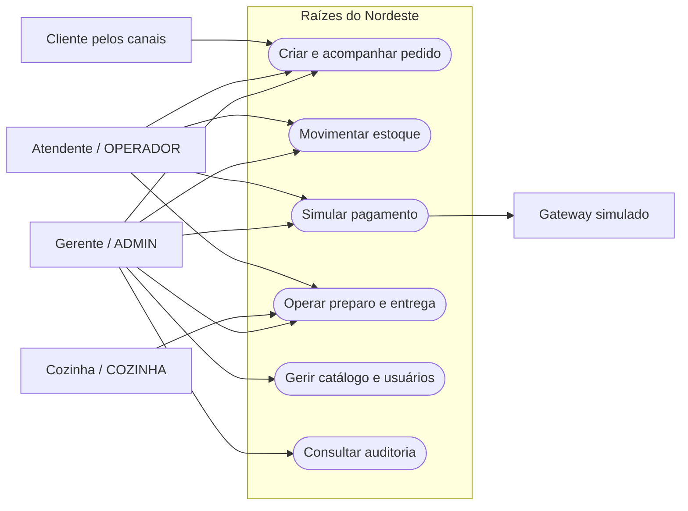
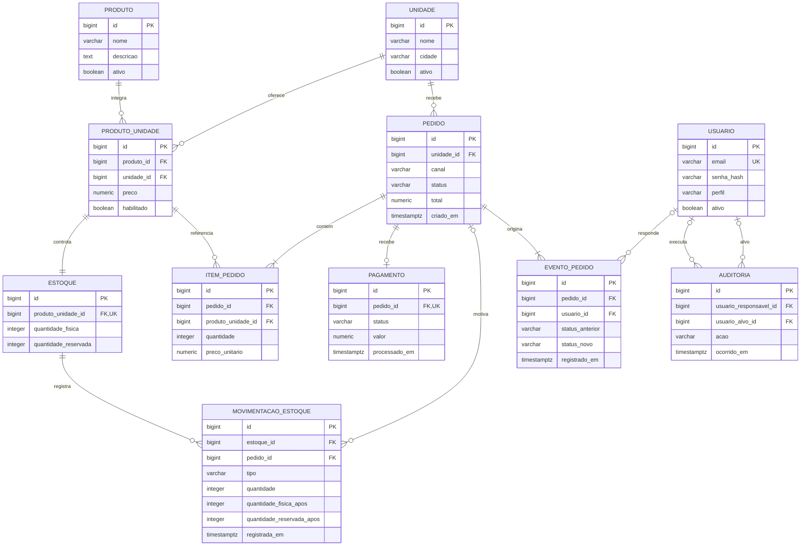
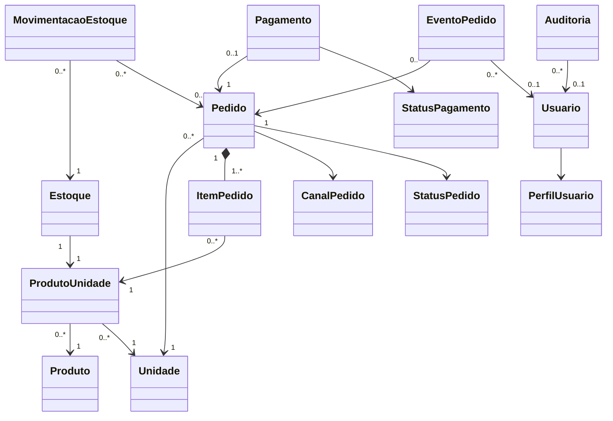
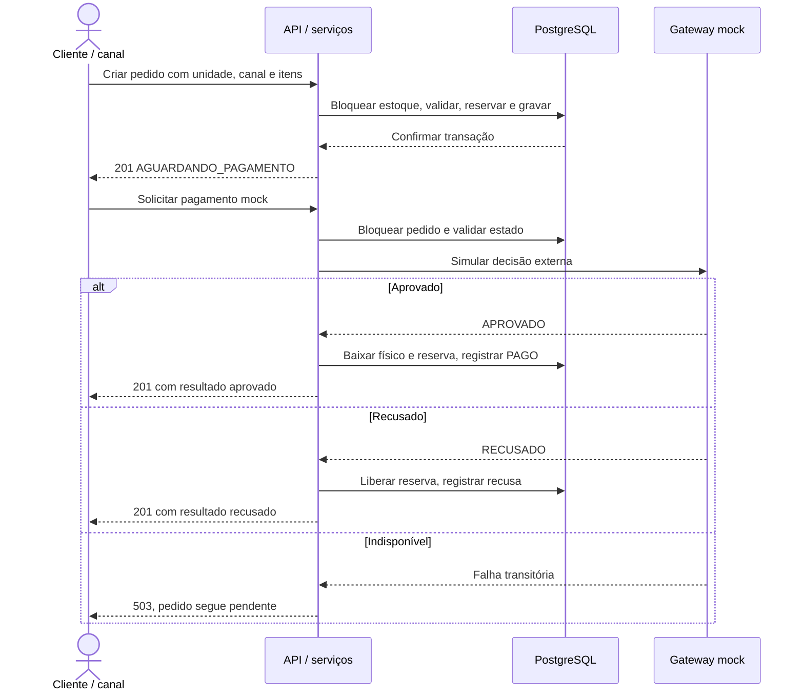

# Especificação da API Raízes do Nordeste

## 1 INTRODUÇÃO E ANÁLISE DO PROBLEMA

A Raízes do Nordeste precisa operar restaurantes com preços, cardápios e saldos próprios, recebendo pedidos em cinco canais. Um cadastro global de produtos evita duplicidade. A associação com cada unidade registra o preço e a disponibilidade locais. Vendas simultâneas e falhas no pagamento exigem uma regra comum para preservar o estoque e explicar a situação de cada pedido.

O objetivo geral é implementar uma API REST que receba uma venda multicanal, reserve o saldo da unidade, simule o processamento financeiro e acompanhe as etapas até a entrega. Os objetivos específicos são proteger as operações por perfil, persistir resultados e trilhas de auditoria, divulgar o contrato HTTP e verificar as condições de sucesso e de erro.

O MVP segue o fluxo A do roteiro, pedido, pagamento simulado e atualização de status. Catálogo, estoque, controle de acesso e auditoria sustentam esse fluxo. Fidelidade e campanhas recebem tratamento conceitual na seção 8. Os canais são origens declaradas no pedido. O cliente usa um canal atendido pela rede, enquanto esta API recebe a operação sob uma conta autorizada.

## 2 REQUISITOS E PRIORIZAÇÃO

| ID | Requisito funcional | Critério de aceitação |
| --- | --- | --- |
| RF01 | Cadastrar e autenticar equipe | ADMIN cadastra contas. O login emite JWT para credenciais válidas. |
| RF02 | Manter produtos e unidades | Criar e consultar produtos globais e filiais com identificadores próprios. |
| RF03 | Configurar cardápio por unidade | Preço e disponibilidade pertencem ao vínculo produto–unidade. O vínculo é único. |
| RF04 | Movimentar estoque | Entrada e saída manual registram quantidade e saldo. Saída respeita quantidades reservadas. |
| RF05 | Criar e consultar pedidos | Exigir unidade, canal válido e itens da mesma unidade. Reservar saldo e guardar preços. |
| RF06 | Registrar pagamento simulado | Aprovar com baixa, recusar com liberação ou devolver 503 com saldo e pedido preservados. |
| RF07 | Operar e cancelar pedidos | Aplicar transições previstas. Cancelar pendentes libera reserva. Registrar eventos. |
| RF08 | Auditar acesso e alterações | ADMIN consulta eventos e trilha de acesso às contas. Movimentos explicam alterações de saldo. |
| RF09 | Definir fidelidade e promoções | Documentar regras de crédito, resgate, campanhas, consentimento e reversão. |

| ID | Requisito não funcional | Controle ou meta |
| --- | --- | --- |
| RNF01 | Integridade transacional | Em disputa pela última unidade, apenas um pedido pode ser aceito. As alterações de uma venda são atômicas. |
| RNF02 | Segurança | BCrypt, JWT com assinatura e validade, autorização por função e HTTPS em implantação. |
| RNF03 | Integridade do armazenamento | Flyway versiona alterações e Hibernate valida o mapeamento. Preços e totais usam decimal com duas casas. |
| RNF04 | Contrato verificável | OpenAPI descreve operações. DTOs validam campos. Erros HTTP esperados usam ProblemDetail. |
| RNF05 | Privacidade | Coletar apenas dados necessários, impedir exposição de credenciais e definir retenção por finalidade. |
| RNF06 | Desempenho e disponibilidade | Consultas paginadas quando previstas, índices de pesquisa e transações curtas. Meta proposta de p95 abaixo de 500 ms para consultas em ambiente controlado, a medir sob carga. |
| RNF07 | Tolerância a falhas | Indisponibilidade financeira dá 503, sem alterar estoque e pedido. Tentativas posteriores devem respeitar o estado já confirmado. |

**Prioridade.** O fluxo obrigatório inclui RF01 a RF08, com ênfase nas reservas concorrentes, no pagamento e nos perfis. RF09 é proposta. Rate limiting distribuído, métricas operacionais, prevenção de incidentes e alta disponibilidade ficam para evolução de implantação.

## 3 MODELAGEM E ARQUITETURA

### 3.1 Arquitetura em camadas e atores

Os controllers definem rotas e status e recebem DTOs validados. Os serviços aplicam regras de negócio e delimitam transações. Repositórios Spring Data JPA executam consultas e bloqueios. O domínio concentra estados e regras de mudança. PostgreSQL mantém chaves, unicidade e checks. A cadeia Spring Security autentica Bearer JWT e autoriza perfis. O advice padroniza falhas de negócio, enquanto a cadeia de segurança produz 401 e 403 no mesmo formato de erro.

O cliente origina o pedido pelos canais APP, TOTEM, BALCAO, PICKUP e WEB. O atendente corresponde a OPERADOR. A cozinha acompanha a fila e registra etapas de preparo. O gerente corresponde a ADMIN, com gestão de catálogo, usuários e auditoria. O gateway é um colaborador simulado pelo sistema, representado como participante externo no modelo lógico. As permissões de cada ator estão detalhadas na matriz de segurança.



### 3.2 Diagrama entidade-relacionamento



Os IDs são chaves primárias. ProdutoUnidade tem chave única composta por produto e unidade. Estoque tem um vínculo único por item de cardápio e mantém `0 ≤ reservado ≤ físico`. Cada ItemPedido identifica um produto da unidade, com quantidade positiva e preço congelado. Um pagamento finalizado por pedido é assegurado por unicidade. Reposição e saída manual têm vínculo opcional com pedido. EventoPedido guarda a mudança de estado, horário e responsável. Auditoria registra o ator e, quando aplicável, a conta alvo. As referências opcionais ao usuário permitem preservar os eventos se uma conta for removida.

### 3.3 Diagrama de classes



`Pedido` concentra o total, os itens e o status. `Estoque` conserva saldo físico e reservado e aplica a regra da disponibilidade. `ProdutoUnidade` representa preço e habilitação local. `Pagamento`, `EventoPedido` e `MovimentacaoEstoque` materializam o resultado e a rastreabilidade.

## 4 CASO DE USO CRÍTICO

**UC01 | Realizar pedido e registrar pagamento.** O cliente seleciona itens em um canal. Atendente ou canal autorizado registra o pedido. O gateway simulado devolve o resultado. A equipe de cozinha opera a fila após confirmação financeira.

**Pré-condições.** Sessão autorizada, unidade ativa, produtos globais ativos, vínculos habilitados na mesma filial, quantidades válidas e saldo disponível. O pagamento exige pedido aguardando pagamento.

**Fluxo principal.** 1. Receber `unidadeId`, `canalPedido` e itens. 2. Carregar vínculos e bloquear linhas de estoque em ordem crescente de identificador. 3. Verificar saldo, guardar preço vigente, calcular total e reservar quantidades. 4. Persistir pedido em AGUARDANDO_PAGAMENTO, evento inicial e movimentações. 5. Receber a simulação, bloquear o pedido e verificar seu estado. 6. Se aprovado, baixar físico e reservado, gravar pagamento e marcar PAGO. 7. Registrar as etapas operacionais permitidas até ENTREGUE.

**Pós-condições.** Aprovação grava um pagamento, diminui físico e reservado e gera eventos. Recusa grava o resultado, libera a reserva sem reduzir o físico e marca PAGAMENTO_RECUSADO. Cancelamento de pedido pendente também libera a reserva e registra CANCELADO. Após PAGO, as etapas seguem EM_PREPARO, PRONTO e ENTREGUE, nessa ordem. COZINHA opera preparo e prontidão. OPERADOR registra a entrega. ADMIN executa as três etapas.

| Cenário alternativo | Resposta e efeito |
| --- | --- |
| Unidade ou vínculo inexistente | 404. Sem reserva ou pagamento. |
| Campo inválido ou canal ausente | 400. Validação interrompe a operação. |
| Estoque insuficiente ou item indisponível | 409. A transação deixa os saldos anteriores intactos. |
| Pagamento repetido ou estado incompatível | 409. O resultado persistido prevalece. |
| Gateway mock indisponível | 503. Pedido e reservas anteriores permanecem e a tentativa pode ser repetida. |
| Cancelamento ou transição inválidos | 409. O estado e o saldo já gravados são preservados. |



## 5 IMPLEMENTAÇÃO, PERSISTÊNCIA E CONTRATOS

Java 21, Maven e Spring Boot 4.1.2 compõem a aplicação. PostgreSQL 16 armazena catálogo, estoque, vendas e usuários. Flyway aplica migrations incrementais, preservando o catálogo da V1. A V2 introduz vendas, movimentos e eventos, a V3 cria usuários e a V4 incorpora etapas operacionais e autoria dos eventos. A V5 amplia os perfis e inclui auditoria de acessos a contas. A V6 habilita saídas manuais na trilha de estoque.

A reserva consulta o saldo já bloqueado. Se outra transação confirmar antes, a próxima verifica o saldo atualizado. Em pedidos com vários itens, a ordenação dos bloqueios reduz risco de deadlock. O pagamento bloqueia a linha do pedido antes de mover o estoque. Criação, resultado e cancelamento usam transações para preservar consistência. O mock é local e mantém a transação curta. Uma integração real exige timeout, chave de idempotência e reconciliação de resultados.

| Operações | Entrada ou consulta | Resposta principal |
| --- | --- | --- |
| POST /auth/login | email, senha | 200 com token Bearer, perfil e validade |
| POST /usuarios; GET /usuarios; GET /usuarios/{id} | Cadastro com email, senha e perfil, consultas administrativas | 201 ou 200 sem hash de senha |
| POST /produtos; GET /produtos; GET /produtos/{id} | nome e descrição; consulta global | 201 ou 200 |
| POST /unidades; GET /unidades; GET /unidades/{id} | nome e cidade; consulta de unidades | 201 ou 200 |
| POST /unidades/{id}/cardapio | produtoId, preco, habilitado | 201 |
| PUT /unidades/{id}/cardapio/{vinculo} | preco, habilitado | 200 |
| GET /unidades/{id}/cardapio e detalhe | Identificação da unidade e, no detalhe, do vínculo | 200 |
| GET /unidades/{id}/estoque | Identificação da unidade | 200 com físico, reservado e disponível |
| GET /unidades/{id}/estoque/{vinculo} e /movimentacoes | Identificação da unidade e do vínculo, página do histórico | 200 com saldo ou movimentos |
| POST /unidades/{id}/estoque/{vinculo}/reposicoes ou /saidas | quantidade positiva | 200 com saldo atualizado |
| POST /pedidos; GET /pedidos; GET /pedidos/{id} | unidadeId, canalPedido, itens; filtro e paginação | 201 ou 200 |
| POST /pedidos/{id}/pagamentos | aprovado obrigatório, indisponivel opcional | 201 no resultado; 503 e Retry-After na indisponibilidade |
| PATCH /pedidos/{id}/status | status operacional autorizado | 200 |
| POST /pedidos/{id}/cancelamentos | Identificação do pedido pendente, sem corpo | 204 |
| GET /pedidos/{id}/eventos; GET /auditorias | Consultas administrativas de rastreabilidade | 200 |

O pedido guarda `canalPedido` como enum do domínio e aceita APP, TOTEM, BALCAO, PICKUP e WEB. Para filtrar, use `GET /pedidos?canalPedido=TOTEM&page=0&size=20`. As listagens paginadas retornam conteúdo, página, tamanho e totais. O OpenAPI é publicado em `/v3/api-docs` com interface em `/swagger-ui.html`. O HTTP 400 indica contrato inválido, 401 credencial ausente ou inválida, 403 acesso fora do perfil, 404 recurso ausente, 409 conflito de estoque ou estado e 503 falha temporária da simulação.

```json
{
  "unidadeId": 1,
  "canalPedido": "TOTEM",
  "itens": [{"produtoUnidadeId": 12, "quantidade": 2}]
}
```

## 6 SEGURANÇA, LGPD E AUDITORIA

### 6.1 Acesso e segurança

| Perfil ou ator | Permissão principal |
| --- | --- |
| Cliente por canal | Origina a venda. A API operacional é chamada por um atendente ou por integração autorizada. |
| OPERADOR | Consulta catálogo e estoque, registra movimentos, cria pedidos e simula pagamentos nas rotas permitidas. |
| COZINHA | Consulta pedidos e registra EM_PREPARO e PRONTO. |
| ADMIN | Gerencia produtos, unidades, cardápio e usuários, opera o fluxo e consulta auditorias. |
| Gateway simulado | Produz decisão controlada de aprovação, recusa ou indisponibilidade. |

Credenciais em produção devem trafegar por HTTPS. A aplicação guarda hash BCrypt e emite JWT com validade curta, assinatura, emissor e audiência verificados. O segredo vem do ambiente e o token usa um identificador interno como assunto. Senhas, hashes e tokens inteiros não integram a trilha de auditoria. Uma conta de gestão inicia o cadastro de perfis, com credenciais provisionadas sem exposição no repositório.

### 6.2 Tratamento e ciclo de vida de dados

| Dado pessoal ou vínculo | Finalidade e base a avaliar | Retenção operacional proposta |
| --- | --- | --- |
| E-mail profissional, perfil e identificador de conta | Operar contas da equipe e aplicar privilégios, art. 7º, V ou IX, conforme vínculo e avaliação do controlador. | Desativar no fim do vínculo. Revisar a necessidade de identificação após 90 dias. |
| Hash de senha | Verificar autenticação. Segue a finalidade da conta. | Remover quando eliminar a conta. Restringir o acesso técnico no período ativo. |
| Ação administrativa, ator e horário | Prestar contas e apurar acessos, art. 7º, IX, com avaliação de necessidade. | Revisar após 180 dias. Conservar quando houver obrigação ou apuração formal. |
| Canal, pedido e valores | Executar e auditar a operação comercial, art. 7º, V, se houver vínculo a pessoa. | Minimizar vínculo pessoal. Retenção fiscal e comercial segue política da rede e obrigações aplicáveis. |
| Adesão e preferências de fidelidade propostas | Adesão facultativa e comunicação com finalidades separadas, art. 7º, I e art. 8º. | Guardar prova proporcional de aceite e revogar de forma simples. Revisar retenção após desligamento. |

O MVP não recebe CPF, contato do consumidor, dados de cartão ou categorias especiais de dados. E-mail profissional e identificador do funcionário podem ser dados pessoais. Acessos administrativos às contas, mudanças de estado e alterações de estoque têm trilhas de auditoria. Perfis e responsáveis restringem acesso aos registros. O responsável por privacidade deve manter inventário de tratamento, avisos e canal para exercício de direitos.

Os prazos da tabela são uma proposta de governança, sujeita a revisão pelo controlador. Eliminar ou anonimizar dados ao encerrar a finalidade, observadas as hipóteses de conservação do art. 16. Consentimento, quando for a base escolhida, deve ser específico, demonstrável e revogável. Aplicam-se os princípios de finalidade, necessidade e segurança e os direitos dos titulares previstos na LGPD (Brasil, 2018).

## 7 PLANO DE TESTES E EVIDÊNCIAS

A coleção em `docs/raizes-api.postman_collection.json` usa variáveis para tokens e IDs. Execute a ordem de preparação, autenticação, cadastro, estoque, pedido e pagamento em um banco de testes. Os códigos C abaixo identificam a matriz de cobertura do relatório. A execução usa os identificadores T01 a T48 da coleção.

| ID | Endpoint e pré-condição | Entrada | Resultado esperado |
| --- | --- | --- | --- |
| C01 | POST /auth/login; conta ativa | E-mail e senha válidos | 200, JWT e perfil |
| C02 | GET /produtos; sem autenticação | Cabeçalho ausente | 401 em ProblemDetail |
| C03 | POST /produtos; OPERADOR | Cadastro válido | 403 em ProblemDetail |
| C04 | POST /produtos; ADMIN | Nome e descrição | 201 com Location |
| C05 | POST /pedidos; equipe autenticada | Sem canalPedido | 400 em ProblemDetail |
| C06 | POST /pedidos; equipe autenticada | Canal desconhecido | 400 em ProblemDetail |
| C07 | POST /pedidos; vínculo ativo com saldo | Canal válido, itens e quantidades | 201 em AGUARDANDO_PAGAMENTO |
| C08 | GET /produtos/{id}; equipe autenticada | ID inexistente | 404 em ProblemDetail |
| C09 | POST /pedidos; saldo inferior ao pedido | Quantidade acima do disponível | 409 e saldo preservado |
| C10 | POST /pedidos/{id}/pagamentos; pendente | aprovado=true | 201, PAGO e baixa física |
| C11 | POST /pedidos/{id}/pagamentos; pendente | aprovado=false | 201, PAGAMENTO_RECUSADO e liberação |
| C12 | POST /pedidos/{id}/pagamentos; pendente | aprovado=true, indisponivel=true | 503, Retry-After e nova tentativa possível |
| C13 | PATCH /pedidos/{id}/status; pedido pago | EM_PREPARO | 200, evento registrado |
| C14 | GET /auditorias; consulta prévia de conta | Token ADMIN | 200, trilha da ação |
| C15 | POST /pedidos concorrentes; saldo de uma unidade | Duas requisições com quantidade um | Um 201 e um 409 |
| C16 | POST /pedidos/{id}/cancelamentos; pendente | ID do pedido | 204, CANCELADO e reserva liberada |
| C17 | GET /pedidos; pedidos de canais diferentes | canalPedido=TOTEM, page=0 | 200 com a página filtrada |
| C18 | POST /unidades/{id}/estoque/{vinculo}/saidas; saldo livre | Quantidade positiva disponível | 200 com baixa e movimento SAIDA |

**Execução verificada.** O Maven Wrapper concluiu o empacotamento e passou os 23 testes JUnit. O Newman executou 48 cenários HTTP, sendo 31 positivos e 17 negativos, com 116 asserções aprovadas em PostgreSQL 16.12 temporário. A execução usou o JAR empacotado e aplicou as migrations V1 a V6.

**Verificações adicionais.** A disputa pela última unidade e a disputa pelo pagamento de um mesmo pedido produziram, cada uma, um HTTP 201 e um 409. No pagamento aprovado, as quantidades física e reservada ficaram em zero no cenário de uma unidade. O Swagger UI e o JSON OpenAPI responderam por HTTP. Os retornos de T01 a T48 e a reprodução constam em `docs/evidencias-testes.md`. Os contratos detalhados estão em `docs/contratos-api.md`.

## 8 FIDELIDADE E CAMPANHAS PROPOSTAS

O programa de fidelidade é facultativo. Proposta inicial: creditar um ponto a cada R$ 5,00 completos do valor líquido pago, arredondando para baixo. Uma compra líquida de R$ 47,50 gera 9 pontos. Os pontos vencem 180 dias após crédito. O extrato registra crédito, resgate, expiração e estorno, com chave única pelo evento de origem. Pedido recusado ou cancelado não gera crédito.

O resgate proposto debita 40 pontos em troca de R$ 8,00 de desconto, respeitando limite de 20% do valor líquido elegível. Um pedido elegível de R$ 50,00 pode receber o resgate e seguir por R$ 42,00, que gerariam 8 novos pontos. Em um pedido de R$ 30,00, o resgate não é habilitado porque R$ 8,00 excede o limite. Pontos reservados para pagamento são devolvidos na recusa. Reembolso posterior deve estornar o crédito vinculado à venda.

Campanha piloto: 10% para itens elegíveis da filial participante em APP e WEB, em período informado, com desconto máximo de R$ 15,00 por pedido. A aplicação registra regra e versão, canal, filial e valores antes e depois do desconto. Exemplo: cesta elegível de R$ 160,00 recebe R$ 15,00 pela limitação. Campanha e resgate não acumulam no piloto. Em caso de alternativas, o cliente recebe o melhor desconto ao confirmar. Cupons limitados exigem reserva de uso e controle concorrente.

O aceite de fidelidade registra identificador da pessoa, finalidade, versão do aviso, data, canal e estado. Preferências de comunicação são solicitadas separadamente. A recusa ou a revogação preserva a compra ordinária. Uma rotina futura deve extinguir o tratamento facultativo e conciliar o extrato, a expiração e eventual obrigação de conservação.

## 9 CONCLUSÃO

O desenho trata o pedido como uma operação conjunta de cardápio, estoque, pagamento e trilha de mudanças. A persistência de preço e a reserva transacional preservam a consistência quando os canais compartilham o mesmo estoque. O contrato HTTP e a coleção permitem reproduzir os principais resultados e distinguir falhas de entrada, autorização, negócio e integração.

A integração financeira continua simulada. Alta disponibilidade, limites de tráfego, monitoramento contínuo, um provedor real e fidelidade permanecem como evoluções. Retenção e bases de tratamento devem ser validadas pela organização antes de implantação real. O projeto acadêmico foi preparado para entrega local. A publicação do repositório e o envio pelo ambiente acadêmico ficam pendentes de decisão do autor.

## REFERÊNCIAS

ASSOCIAÇÃO BRASILEIRA DE NORMAS TÉCNICAS. **ABNT NBR 14724**: informação e documentação - trabalhos acadêmicos - apresentação. Rio de Janeiro: ABNT, 2024.

ASSOCIAÇÃO BRASILEIRA DE NORMAS TÉCNICAS. **ABNT NBR 6023**: informação e documentação - referências - elaboração. Rio de Janeiro: ABNT, 2025.

ASSOCIAÇÃO BRASILEIRA DE NORMAS TÉCNICAS. **ABNT NBR 6027**: informação e documentação - sumário - apresentação. Rio de Janeiro: ABNT, 2012.

ASSOCIAÇÃO BRASILEIRA DE NORMAS TÉCNICAS. **ABNT NBR 10520**: informação e documentação - citações em documentos - apresentação. Rio de Janeiro: ABNT, 2023.

BRASIL. **Lei nº 13.709, de 14 de agosto de 2018**. Lei Geral de Proteção de Dados Pessoais. Brasília, DF: Presidência da República, 2018. [Texto compilado](https://www.planalto.gov.br/ccivil_03/_ato2015-2018/2018/lei/l13709compilado.htm). Acesso em 19 nov. 2026.

POSTGRESQL GLOBAL DEVELOPMENT GROUP. **PostgreSQL 16 documentation: explicit locking**. [Documentação](https://www.postgresql.org/docs/16/explicit-locking.html). Acesso em 19 nov. 2026.

SPRING. **Spring Framework: error responses**. [Documentação](https://docs.spring.io/spring-framework/reference/web/webmvc/mvc-ann-rest-exceptions.html). Acesso em 19 nov. 2026.

UNINTER. **Roteiro de atividade prática - Projeto Back End**. 2026. Requisitos consultados na transcrição do checklist oficial fornecida para o projeto.

## APÊNDICE A - DECLARAÇÃO DO USO DE IA

Foi utilizado o assistente ChatGPT/Codex, da OpenAI, durante a construção deste projeto. O autor forneceu o problema, as decisões de escopo, o roteiro transcrito e as instruções por etapa. O assistente gerou e revisou parte dos fontes Java e SQL, scripts de validação, exemplos do contrato, texto técnico e diagramas. A formatação do relatório foi produzida com Python e ReportLab e conferida com renderização do PDF.

Exemplos de prompts efetivamente usados: “cria o controller”; “agora vamos pro service”; “crie o dto do produto o request e o response use record, notblank e size [...]”; “consegue terminar hoje?” seguido do mapa de módulos, fluxo transacional e entregáveis. A revisão anterior também orientou explicitamente a alteração de `buscarPorId` para lançar `RecursoNaoEncontradoException` com tratamento central.

Foram aproveitados trechos de código de DTOs, services, controllers, migrations e testes, a organização dos requisitos, exemplos de HTTP e a síntese dos diagramas e das propostas de fidelização. Dois trechos específicos são a validação `@NotBlank @Size(max = 255)` do nome em ProdutoRequest e a busca por ID com `orElseThrow` em ProdutoService, acompanhada da conversão da exceção em ProblemDetail no advice. As evidências registradas correspondem a execuções distintas do trabalho de redação. A responsabilidade pela revisão acadêmica e pela entrega permanece com o autor.
